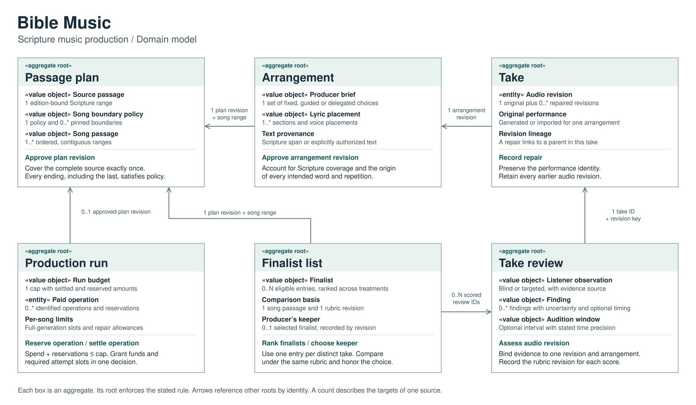

# Bible Music

Bible Music is a local production workbench for turning Scripture into songs that people can memorize word for word. The producer chooses a Bible edition and a source passage, directs the music, and picks the recording to keep. The workbench’s job is to make it quicker to find performances worth hearing and easier to hear exactly where a promising take goes wrong.

A listener might transcribe *fulfillment* correctly while the singer audibly drops the first “l.” The producer needs the recording, the phrase to audition, and the option to repair or reject that take. The workbench therefore preserves the Scripture as written, the arrangement as intended, and the performance as heard. Each answers a different question in review.

## From passage to a keeper

| Producer decision | How the workbench should respond |
| --- | --- |
| Choose the source | Resolve the translation, text edition and range. A whole book such as Titus is a **source passage**. Each contiguous span assigned to one song is a **song passage**. Reject a nonexistent chapter such as Titus 4. |
| Decide where songs end | Set every cut, pin particular cuts or delegate the plan to the artist. Choose sentence endings, sentence endings or semicolons, or any whole word. Optionally require verse ends as well. Preview conflicts, including at the final word. The approved songs cover the entire source exactly once in order. |
| Direct the artist | Set **structure**, **genre** and **generation prompt** independently to fixed, guided or delegated. Set how adventurous the artist may be about open choices, with guidance such as “let EDM lead and experiment with brass.” A fixed prompt passes verbatim. Surface conflicts between fixed instructions for the producer to resolve. Additional sung words require explicit permission. |
| Arrange and record | Capture the expected words in each section and vocal part, including declared echoes, overlapping lines and refrains. Generate full performances with Mureka or import recordings with their arrangements. Each performance is a **take**. |
| Listen and repair | First listen blind to the recording. Compare the observation against the arrangement, then perform targeted musical and pronunciation checks using the producer’s rubric. Jump to a finding when timing is available. A local SoundCraft edit or a region regeneration produces a new **audio revision** of the same take. Review the full render and its joins. |
| Audition finalists | Rank the strongest eligible recordings for **each song passage** under the same rubric revision. The default is three, pooled across genres and arrangements, with at most one revision of each distinct take. All three may be in one genre. The producer auditions the finalists, chooses a **keeper** and exports that exact WAV. |

One main run workspace should show the current passage, artist controls, selected QA model, progress, outstanding costs and remaining attempts alongside the audition queue. Settings hold provider configuration and credential references. The producer sets one dollar cap for the run and a full-generation attempt limit for each song passage. Every billable operation reserves its maximum expected cost first. A restart reconciles the original operation before more money is committed. [Production workflow and decision points](docs/workflows/production.md)

## The domain model

The model treats Scripture music production as one bounded context. Each outlined group has a root responsible for a consistency rule. A **take** keeps its identity when repaired. An **audio revision** has identity within that take. An **audition window** is a value whose meaning comes from its endpoints and timing precision. A review names the exact revision it assessed. That distinction prevents a corrected recording from inheriting an obsolete verdict.

The diagram and the glossary use the same words as a producer auditioning a recording. A change to what *take* means belongs in that conversation, in the model and in the acceptance examples. Open the single-canvas model in diagrams.net or a compatible diagrams.net integration in PyCharm. [Editable domain model](docs/domain/domain-model.drawio) · [Ubiquitous language](docs/domain/ubiquitous-language.md) · [PyCharm diagram plugin](https://plugins.jetbrains.com/plugin/15635-diagrams-net-integration) · [Eric Evans, Domain-Driven Design Reference](https://www.domainlanguage.com/wp-content/uploads/2016/05/DDD_Reference_2015-03.pdf)

## Architecture

The intended implementation is a Python modular monolith using Clean Architecture and ports and adapters. Source dependencies point inward. At runtime a use case calls an injected adapter through a port the use case owns.

| Component | Responsibility |
| --- | --- |
| Domain | Validates a passage plan, preserves an arrangement’s permitted lyrics, accounts for reservations and selects eligible finalists. Plain Python expresses these rules. |
| Application | Coordinates review, repair, generation and audition. Defines narrow ports for reading Scripture, generating audio, listening, rendering and persistence. Chooses when to use each one. |
| Adapters | PySide6 handles producer interaction. Mureka, SoundCraft, listening models, SQLite, local audio files and the credential store each translate between an outside system and an application contract. |
| Composition root | Selects replay or live implementations and wires them into the same use cases. Durable execution can use LangGraph when paid-job recovery or a paused audition gives it a concrete job. |

