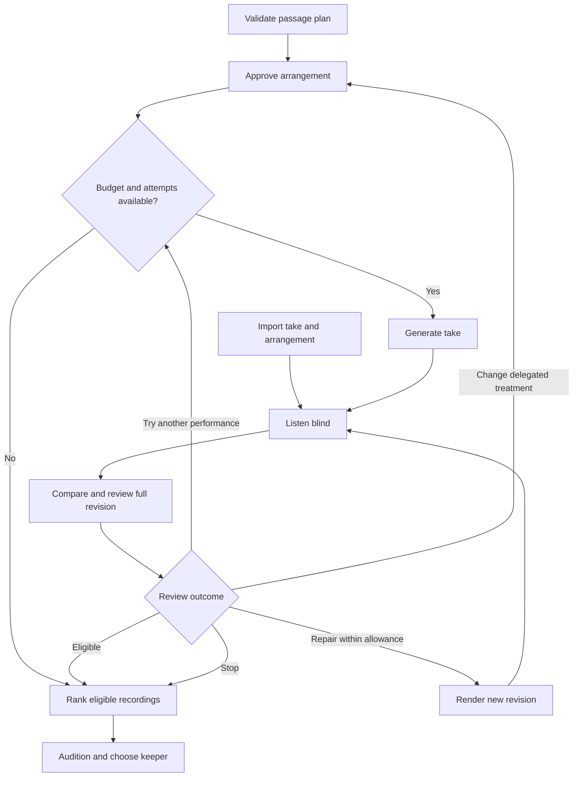

# Producing a song passage

The producer can enter at planning with a source passage or at review with an existing recording and its arrangement. Each generated performance has its own take identity. A repair changes the audio revision that needs review.

| Decision | What the producer sees |
| --- | --- |
| A pinned or terminal cut conflicts with the policy | The edition, offending position and constraints, with legal neighboring choices where available. The producer can revise the range, break or policy before generation. |
| The provider may have accepted a timed-out operation | A pending operation with its reservation. The workbench polls the known job, reconciles the request, or leaves it for human reconciliation. |
| A targeted check finds a questionable word | The actual mix or vocal evidence, revision, uncertainty and a playable phrase when timing is available. Approximate and inferred locations are identified. |
| A local cut or regenerated phrase is rendered | A new revision of the same take. Listen to the phrase, both joins where applicable, and the complete mix before scoring it. |
| A repair, attempt or spend limit is reached | The current eligible shortlist and the reason work stopped. A shortage of eligible recordings yields a shorter list. |
| The producer chooses a keeper | Export the selected revision as a WAV and retain its arrangement, review and rubric revision. |

Reserve before **every billable step** in this flow, including artist proposals and listening. Stored observations drive this same workflow during offline acceptance. [Operation and recovery decision](../decisions/0002-replaceable-workflow-steps.md)
